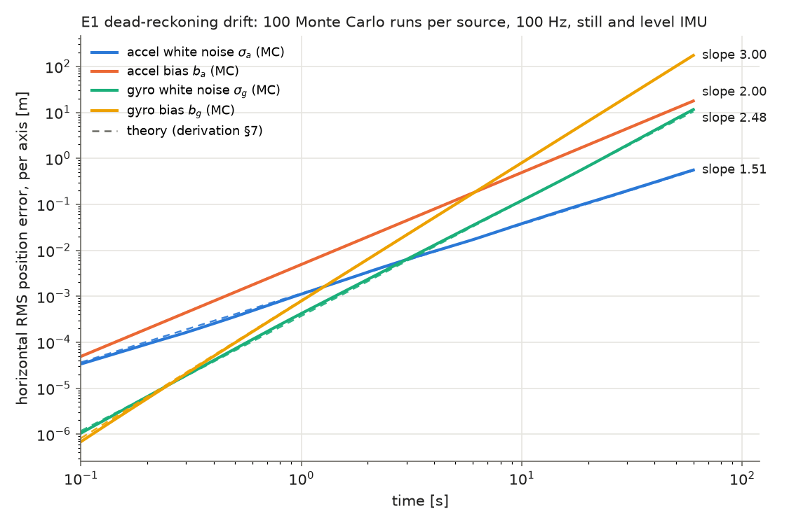
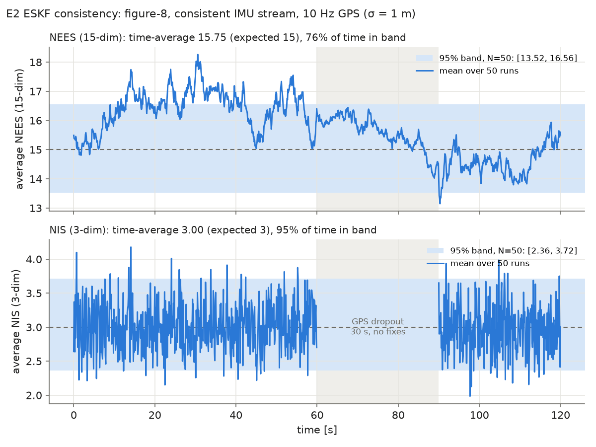
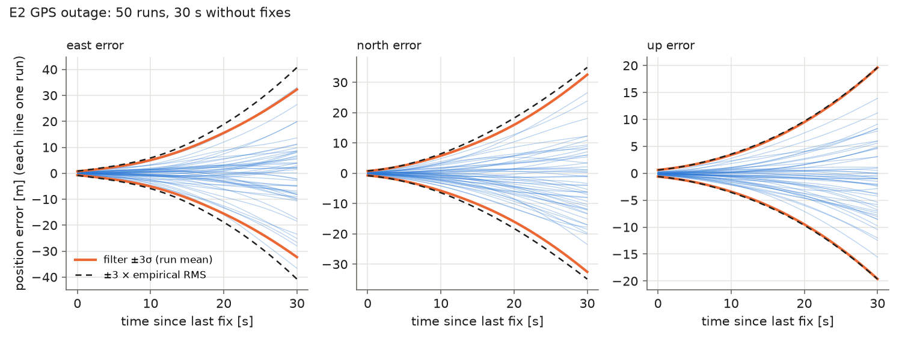

# Results

Every number here says which simulator stream produced it (conventions §7).
Regenerate with the command given in each section.

## E1: simulator and IMU dead reckoning

Code: `python/navekf_py/` (`sim.py`, `propagate.py`, `so3.py`). Tests: `pytest` (53 tests, ~3 s on an M4 Air).

### Exactness and convergence

| Check | Stream | Setup | Result | Required |
|---|---|---|---|---|
| Noise-free DR vs `q, v, p_ref` | consistent | figure-8, 60 s at 200 Hz (12 001 samples) | max errors: `p` 1.7e-11 m, `v` 6.3e-13 m/s, `q` 3.3e-14 rad | < 1e-9 |
| `p_ref` (§6 recursion) vs analytic `p` | consistent | same | 3.7e-6 m | (trapezoid error, for reference) |
| Noise-free DR vs analytic truth, max ‖δp‖ over 30 s | analytic | 100 / 200 / 400 Hz | 0.177 / 0.088 / 0.044 m, fitted slope **1.00** in `dt` | O(dt) |

`tests/test_propagate.py::test_consistent_stream_dead_reckoning_is_exact`,
`::test_analytic_stream_error_is_first_order`.

### Drift laws (derivation §7)

Still, level IMU, 60 s at 100 Hz, **100 Monte Carlo runs per source**, one source
on at a time, run `i` seeded with `0 + i`. The error is the per-axis horizontal
RMS position error. Biases are constant per run, drawn `N(0, value²)` per axis.

| source | value | RMS/theory at 10 s | at 60 s | min–max (t ≥ 1 s) | fitted slope | theory |
|---|---|---|---|---|---|---|
| accel white noise `σ_a` | 2e-3 m/s²/√Hz | 1.042 | 1.039 | 0.965–1.055 | 1.512 | 1.5 |
| accel bias `b_a` | 1e-2 m/s² | 0.983 | 0.983 | 0.983–0.983 | 2.000 | 2.0 |
| gyro white noise `σ_g` | 1.7e-4 rad/s/√Hz | 1.022 | 1.107 | 1.004–1.132 | 2.485 | 2.5 |
| gyro bias `b_g` | 5e-4 rad/s | 0.982 | 0.983 | 0.969–0.983 | 3.003 | 3.0 |

All ratios are inside the ±20% sampling band (at 100 runs one point's 1σ is
about 7%), and all slopes are within 0.02 of theory. The bias rows have a
constant ratio because their error is deterministic given the drawn bias:
0.983 is just the sample RMS of the 200 drawn values per axis. The gyro-bias
ratio dips below that at small `t` (0.969 at 1 s) because the start-of-step
hold lags the growing tilt. The discrete sums give `⅙ g b t³ (1 − ~1.5 dt/t)`,
which is −1.5% at `t = 1 s` and 100 Hz. The tests (`tests/test_drift.py`) assert ratio ∈ [0.8, 1.2] for
`t ≥ 1 s` and slope within ±0.1.

Regenerate: `python scripts/plot_drift.py` (~2 s).

## E2: Python ESKF, position updates, NEES/NIS consistency

Code: `python/navekf_py/eskf.py` (filter, step order in its docstring), `consistency.py` (NEES/NIS,
batched Monte Carlo, χ² bands). Tests: `pytest` runs 80 tests in ~5 s (27 new in `test_eskf.py` and
`test_consistency.py`); `pytest -m slow` adds the 50-run test (~8 s). Choices: [`DECISIONS.md`](DECISIONS.md).

### Exactness and Jacobians

| Check | Result |
|---|---|
| Noise-free filter, consistent stream, 20 s, 10 Hz fixes from `p_ref + R l` with `l = [0.3, −0.2, 0.5]` m, updates on | max state error < 1e-9 at every step, max innovation < 1e-9, 201/201 fixes accepted |
| `(J(dt) − I)/dt → F`, with `J` the finite-difference Jacobian of the real §6 step through `⊞/⊖` | first order (error ratio 2.0 per halving); `‖Φ₁ − J‖` ratio 4.0 (`O(dt²)`) |
| `G[:, :6]` vs finite differences of the step w.r.t. the accel/gyro noise | within `5·dt` |
| `‖Φ − expm(F dt)‖`, `‖Q_d − Q_d^{VL}‖` | first order `O(dt²)`, second order `O(dt³)`; Van Loan = `expm` to 1e-13 and = Simpson quadrature to 1e-9 |
| `H` (lever arm ≠ 0) vs finite differences | 1e-9 |
| Reset `G_r` vs finite differences of `(x̂ ⊞ (δx̂ + ε)) ⊖ (x̂ ⊞ δx̂)`, `δθ̂` up to 0.25 rad | 1e-9; the identity reset is off by ≈ ½‖δθ̂‖, Solà's `I − ½[δθ̂]×` by `O(θ²)` |
| Batched filter (2 runs) vs two single-run filters | state 1e-12, `P` rel. 1e-10 |
| Static init, E1's 5 s still segment with noise and `b_g = [1, −2, 0.5]e-3` | roll/pitch < 2e-3 rad, `b_g` < 4e-4 rad/s; on a tilted still IMU (white noise only), within 5σ of the averaging noise |
| Gate | a 20 m outlier gives NIS > 100 and is rejected (state and `P` untouched, logged); no outliers: 1.02% rejected |

### Consistency (the headline)

Figure-8, 120 s at 200 Hz, 10 Hz GPS (σ = 1 m), **30 s dropout at [60, 90) s**
(`configs/e2_consistency.yaml`), **consistent stream**, **50 runs**, seeds 0–49, first-order
discretization, `J_r` reset, honest `P₀` (initial error drawn from it), NIS gate at 11.345. NEES on the 10 Hz
grid (posterior). 6 s on an M4 Air.

| | time-average | 95% band (N = 50) | time inside band |
|---|---|---|---|
| NEES (15) | **15.75** | [13.52, 16.56] | **76%** |
| NIS (3) | **3.00** | [2.36, 3.72] | **95%** |

The NIS is right on. The NEES time-average is inside its band, but this batch sits above the band for
long stretches between 10 and 60 s, so the "inside 95% of the time" reading of "done" is **not met by
seed 0** (76%). Two effects explain it. Neither is a modelling error.

1. **Batch-to-batch variance.** The band is per time step. Bias and attitude errors are correlated over
   tens of seconds, so a 50-run batch wanders as a whole. Ten independent batches (seeds 0–499) give
   NEES time-averages from 14.69 to 15.88 and 74–99% of time in band (seed 0 is one of the high ones).
2. **The 99% gate makes the filter slightly overconfident.** Rejecting the largest 1% of innovations
   leaves exactly those errors uncorrected. Same 500 runs, paired:

| pooled over 500 runs (10 batches) | NEES mean | band (N = 500) | time in band | NIS mean | band | time in band |
|---|---|---|---|---|---|---|
| gate on (11.345) | 15.35 | [14.52, 15.48] | 67% | 3.03 | [2.79, 3.22] | 93% |
| gate off | **15.08** | [14.52, 15.48] | 81% | **3.005** | [2.79, 3.22] | 95% |

With the gate off, the 500-run NEES is 0.5% above 15 (the batch means' standard error is about 0.13),
which is consistent. The gate costs about 2% of NEES. **Gate lock-out:** in 2 of the 500 gated runs (batch
5, seeds 266 and 269) the first fix after the outage failed the gate. Every later fix then failed too (≈310
rejections each, never recovering), because the gate re-tests a large, persistent error against a
covariance that grows no faster. That is the expected ~1%-per-outage hazard of a hard gate, and an E6 item
(e.g. re-open after N consecutive rejections, or a wider gate on the first fix after an outage).

Per-state view (500 runs, gate on, mean of `e²/σ²` by phase): every component is between 0.81 and 1.15.
Position and velocity read 1.03–1.06 with fixes and 1.09–1.13 during the outage. Yaw and `b_gz` read
0.81–0.88 during the outage (pessimistic), and 0.91–0.92 after it. That diagnostic was a one-off script
(not in `run_consistency.py`).

### GPS outage

| time since last fix | RMS error E / N / U [m] | filter σ E / N / U [m] (run mean) | runs inside ±3σ, all axes | mean NEES |
|---|---|---|---|---|
| 0 s | 0.28 / 0.26 / 0.20 | 0.25 / 0.24 / 0.21 | 100% | 16.4 |
| 10 s | 1.97 / 2.14 / 1.18 | 1.70 / 1.93 / 1.14 | 100% | 15.7 |
| 20 s | 6.29 / 6.07 / 3.22 | 5.19 / 5.32 / 3.16 | 98% | 15.6 |
| 30 s | 13.59 / 11.64 / 6.55 | 10.77 / 10.84 / 6.54 | 96% | 14.5 |

The error grows roughly as `t²–t³` (tilt and accel bias, derivation §7), to ~11–14 m horizontal RMS after
30 s, and the filter's 3σ envelope contains 96% of the runs. The vertical σ is exact. Horizontally the
filter is **slightly optimistic in this batch** (σ 10.8 m vs RMS 13.6 m east). Over 500 gate-off runs the
ratio `e²/σ²` at 30 s is 1.16 / 1.08 / 1.10, i.e. about 5% in σ, 2–3 standard errors. The mean NEES over
all 15 states stays at 14.5–16, because yaw and `b_gz` are pessimistic at the same time. Once fixes return
at 90 s, the run-averaged NIS is back inside its band within a few fixes.

### Ablations (does it change NEES?)

Same 50 runs (seeds 0–49), paired. "max |ΔNEES|" is the largest difference of the run-averaged NEES from
the baseline at any time.

| variant | NEES mean | NEES in band | NEES mean t < 10 s | NEES max | NIS mean | NIS in band | rejected | max \|ΔNEES\| | time |
|---|---|---|---|---|---|---|---|---|---|
| **baseline**: first-order, `J_r` reset, honest `P₀` | 15.75 | 76% | 15.5 | 18.3 | 3.00 | 95% | 1.02% | – | 7 s |
| second-order `Φ`, `Q_d` | 15.75 | 76% | 15.5 | 18.3 | 3.00 | 95% | 1.02% | 0.016 | 9 s |
| Van Loan (exact `Φ`, `Q_d`) | 15.75 | 76% | 15.5 | 18.3 | 3.00 | 95% | 1.02% | 0.016 | 24 s |
| identity reset (`G_r = I`) | 15.71 | 79% | 15.4 | 18.2 | 3.00 | 95% | 1.10% | 0.24 | 7 s |
| NIS gate off | 15.48 | 85% | 15.3 | 17.8 | 2.99 | 95% | 0% | 0.60 | 7 s |
| overconfident `P₀` (filter starts at `P₀/100`, σ/10) | 469 | 0% | 1131 | 1520 | 133.5 | 0% | 54.7% | 1.5e3 | 7 s |
| analytic IMU stream (integrator error unmodeled) | 15.83 | 72% | 15.5 | 18.4 | 3.00 | 95% | 1.04% | 0.52 | 8 s |

- **Discretization: no.** At 200 Hz, second order and Van Loan change the run-averaged NEES by at most
  0.016, against a band ±1.5 wide. They are indistinguishable from each other, so the first-order `Φ` is what
  differs, and it doesn't matter. Van Loan costs 3.5× the time.
- **`J_r` vs identity reset: no, within noise.** At most 0.24 at any instant, and no change in the average
  (15.71 vs 15.75). In run 0 the injected `‖δθ̂‖` has a median of 1.5e-3 rad (max 1.7e-2) at 10–60 s and
  3.5e-3 rad (max 1.2e-2) while yaw converges at 1–10 s. So `J_r − I ≈ ½[δθ̂]×` is 1e-3 to 1e-2, which is
  too small to show up against a 15-dim NEES at N = 50.
- **Overconfident `P₀`: yes, badly.** NEES averages 469 over the run and peaks at 1520. The first fixes are judged against a
  0.2 m position σ, so the gate rejects 55% of all fixes, many of them good, while the error sits outside
  the covariance. NEES reaches 1500. This is the gate lock-out above, made systematic. An honest `P₀` (or
  no gate during start-up) is required.
- **Analytic stream: barely.** The O(dt) integrator error (9 cm over 30 s of dead reckoning at 200 Hz, E1)
  is unmodeled but small against the noise. It shifts NEES by at most 0.5 and the average by 0.08.

Regenerate: `python scripts/run_consistency.py` (~4 min with the 10-batch study; `--batches 0 --no-ablations`
for the figures only, ~7 s).
